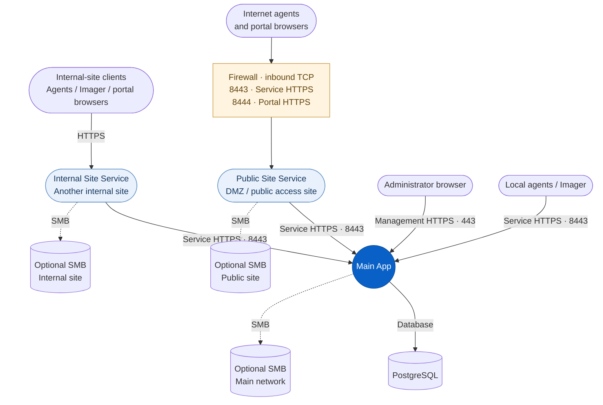

# Architecture Overview

CloneDeploy uses a central Main App to coordinate endpoint management and imaging. Agents, imaging components and optional Site Services connect to it for their assigned work.

## How it works

### Application server

The Main App hosts the web interface and APIs, stores configuration and history in PostgreSQL, and coordinates agent work, image transfers and background tasks. It can run on Windows or Linux and uses administrator-maintained .NET and ASP.NET Core shared runtimes. The Windows installer runs it as a service under a dedicated account; Linux deployments run it under the host's service configuration. The application hosts its own web listeners.

Administrators create device groups, configure actions and policies, manage images, and inspect results through the browser. Image content and action files live in configured storage providers; the database holds their associated records and configuration.

### Endpoint agent

The Windows agent runs as a LocalSystem service, with separate x64 and ARM64 packages. The macOS agent runs as a root-owned launch daemon on Apple silicon. Each platform has a separate Endpoint Portal running in the logged-in user's session.

During enrollment, the agent generates a local identity and requests a device certificate using the installation's provisioning key. Depending on enrollment settings, an administrator may need to approve the device before it can check in normally. The agent's private identity key remains on the endpoint.

After enrollment, the agent authenticates with its device certificate. Its check-in cycle retrieves eligible work and submits information to the server. The default check-in interval is **60 minutes**, configurable from **1 to 1,440 minutes** in Agent administration. Agents receive changed intervals at their next successful check-in.

The agent also maintains a live connection for immediate requests, such as checking in, collecting inventory or starting a direct deployment. These operations depend on connectivity and permissions. An accepted request means the agent received it; completion and results are reported separately. An offline endpoint cannot respond to a live request.

### Policies and direct actions

A policy combines an ordered action sequence with targets, triggers, conditions and execution settings. Saving a policy prepares its configuration; activating it publishes a version for eligible execution. Results appear in policy and device history.

Use policies for repeatable tasks such as installing standard software, applying configuration, or offering approved applications through self service. Use a direct action deployment for an individual operation against selected devices. Review targeting and execution behavior before activating work across a broad group.

Actions must match the endpoint platform. Windows supports Windows-specific operations such as domain join and Windows Update management. The macOS agent supports its own script, command, file and PKG deployment workflows. Windows imaging does not apply to macOS endpoints.

### Imager and WinPE builder

Operating-system capture and deployment run through Imager in Windows PE. The WinPE builder creates boot environments using Microsoft's Windows ADK and WinPE add-on. It runs as a separate privileged Windows service so the web application does not need to perform those build operations itself.

Windows-only preparation can also run on an enrolled Windows Worker. This provides a Windows execution host for a Linux Main App or an installation that separates build work from the application server. The worker contacts the Main App to claim jobs; it does not expose an inbound management or proxy listener.

Administrators build boot environments, which become available automatically with the required settings and drivers. A computer boots the selected environment, connects to the application, and captures or deploys an image. Imaging Tasks provides progress and results. The installed agent can also prepare supported computers to reboot into WinPE for deployment.

### Optional Site Services

A Site Service extends client connectivity and network boot services to another network location. Its roles include an HTTPS reverse proxy for agents and Imager, ProxyDHCP and read-only TFTP. The roles are configured independently after enrollment and approval.

Site Services can run on Windows or Linux. Their role differs from a Windows Worker: a Site Service extends client-facing services at a location, while a Windows Worker executes assigned Windows jobs.

The Main App remains responsible for management, authorization and the database. Site Services synchronize prepared boot files for their boot roles and can replicate content to their configured storage providers, including SMB storage. They can also run enabled multicast sender work when suitable storage is available. They do not have independent management databases.

## Deployment topology

### Single-server installation

A straightforward installation places the Main App, local PostgreSQL, WinPE builder and local content storage on one Windows server. Browsers, agents and Imager connect to that server. This keeps the initial deployment small while providing the main management and imaging workflows.

### Separate database, storage and site services

Distributed installations can use an existing PostgreSQL server, SMB content storage and approved Site Services on additional hosts. Site Services can provide client proxying and local network boot roles while the Main App retains central control.

A Linux Main App follows the same central architecture, with Windows build and preparation jobs assigned to a Windows Worker. Endpoint platform, Main App platform and Site Service platform are separate choices; running the Main App on Linux does not make Windows-only endpoint actions available on a Mac.

Arrows show connection direction; traffic flows both ways. Ports shown are defaults. Allow inbound **TCP 8443** for agent/service traffic and **TCP 8444** for portal browser sign-in to the public Site Service; use the configured listener ports if changed. That service connects to the Main App's service listener over a permitted network path; the management Web UI stays internal. Clients at another internal site connect through their own Site Service.

Dashed links show optional SMB storage accessed by the connected Main App or Site Service. Each share must be reachable from its owning service. This topology does not require exposing SMB to Internet agents. Direct SMB imaging access, when enabled, also requires the relevant WinPE clients to reach the share. Site storage can hold replicated content for local delivery. Local storage is also supported. The diagram focuses on client traffic and storage relationships; build services and network boot protocols are omitted.

Additional Site Services do not make the Main App highly available. The current agent live-connection implementation has no multi-server backplane, so do not assume that placing multiple Main App instances behind a load balancer provides equivalent live-request behavior. Plan database, content and server recovery as part of deployment design.

## Security and access

Web users and managed devices have separate identities. Application accounts receive permissions for administrative and operational tasks; MFA can be required for web and imaging sign-in. Directory inventory alone does not grant access to the management interface.

Enrolled agents use device certificates for authenticated communication. The provisioning key establishes enrollment rather than serving as the normal check-in credential. Certificate-reset requests wait for approval unless automatic reset approval is enabled for eligible requests. Site Services have their own enrollment and approval process, and administrators can disable or revoke their access.

Configure certificate authority and HTTPS before broad deployment, restrict access to administrative interfaces and storage, and protect the server's data and keys. Enabling HTTPS does not remove the HTTP listener: HTTP becomes restricted to boot routes. Agent and service APIs require HTTPS. Firewall rules should reflect the listeners and boot services in use.

Review administrative changes and execution results through audit and history views. Use application users and user groups to assign the access each operator needs.
