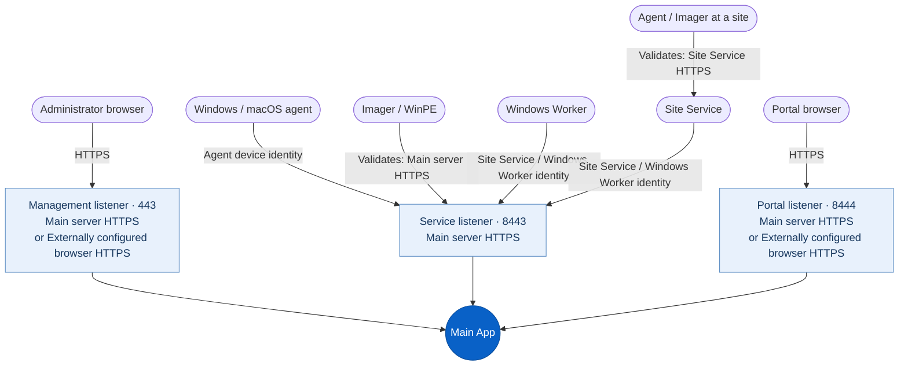

# Certificates

CloneDeploy uses certificates for several independent purposes. Some authenticate network connections, some identify devices or services, and others sign messages or protect stored secrets. They are not interchangeable, even when the same certificate authority issues them.

The sections below explain each certificate's role, where its private key is kept, and how renewal or replacement affects the installation.

## Certificate map

Arrows show connections toward the Main App; traffic flows both ways. All connections shown use HTTPS. Ports are defaults and can be configured. The three listeners belong to the same Main App.

Certificate names match the table below. Listener labels identify the **server certificate** presented to clients. Agent, Site Service and Windows Worker arrows identify the **client identity certificate** used to authenticate back to the server. Labels beginning with **Validates:** identify the server certificate checked by that client, not a client certificate. Imager validates **Main server HTTPS** when connecting directly, or **Site Service HTTPS** through a site; its imaging authentication is separate from certificates.

The installation CA issues the main HTTPS, Site Service HTTPS, and client identity certificates. Management and portal share the same certificate choice: the main HTTPS certificate or one external browser certificate. The service listener always uses the main HTTPS certificate. This certificate arrangement applies to Windows and Linux Main App deployments. Agents also verify server message signatures, including when connecting through a Site Service; signing and other non-connection certificates are detailed below.

Imager additionally establishes encrypted API-session keys with the Main App. Those are temporary protocol keys, not another certificate type or an enrolled agent identity. They do not replace its imaging authorization or the trust required for HTTPS and the server's signed handshake.

| Certificate | What it protects | Issuer and normal lifetime |
| --- | --- | --- |
| Installation root CA | Trust for CloneDeploy-issued identities | Self-signed; 15 years when created by CloneDeploy |
| Main server HTTPS | TLS server identity, including the agent/imaging service listener | Installation CA; up to 365 days |
| Agent device identity (auto-renews) | Device authentication and agent request proofs | Installation CA; up to one year |
| Server message signing (auto-renews) | Main-server response and message authenticity independently of TLS termination | Installation CA; up to 24 hours |
| Site Service / Windows Worker identity (auto-renews) | Authentication of a registered service to the main server | Installation CA; up to 90 days |
| Site Service HTTPS (auto-renews) | TLS identity presented by a site's HTTPS listener | Installation CA; up to 90 days |
| Entra application credential | Application authentication to Microsoft Entra | Separately generated self-signed certificate; one year |
| Windows server secret protection | Database password and Data Protection key protection | Separate installer-created encryption certificate; 15 years |
| Externally configured browser HTTPS | Browser-facing management or portal TLS, when configured | Organization or public CA; lifecycle controlled externally |

Installation-CA-issued certificates cannot outlive that CA. The lifetimes above are issuance limits, not promises that renewal will occur automatically.

## Installation root CA

The root CA is the installation's trust anchor. It signs identities for agents, the main service HTTPS endpoint, Site Services, and server message signing. Its private key remains on the main server; agents and boot media receive only the public certificate.

The CA is created from the certificate administration page. Its certificate and private-key-bearing PFX are stored in the database, with the PFX password protected by the server's secret protection system. Protect the database and the material needed to decrypt it together.

CA trust must be distributed securely. The public CA is not secret, but substituting an attacker's CA changes who the client trusts. A CA returned by an unauthenticated enrollment connection cannot establish trust in that same connection.

The private CA does not publish a CRL or OCSP service. Agent access includes separate server-side checks of registered certificate, issuer, and device status. Do not interpret this as general online revocation checking for all TLS connections.

Replacing the CA affects every identity chained to it. Reissuing a web certificate under the existing CA is different from creating a new CA. Plan replacement as a trust migration, including agent setup material, Site Services, and affected WinPE media. Creating a new root is not a recovery substitute for a lost original signing key.

## Main server HTTPS certificate

This certificate identifies the server during TLS negotiation. It has Server Authentication usage and subject alternative names (SANs) for the DNS names and IP addresses clients use.

Enter those names on the web certificate tab. A URL contributes its hostname; ports and URL paths are not certificate identities. DNS names and IP addresses use different SAN forms. A certificate for a DNS name does not automatically cover connecting by IP address. Wildcards are not supported by the managed certificate generator.

The managed certificate lasts up to 365 days, capped by CA expiry. Issuance and renewal are administrator actions. On installed deployments, issuing or renewing it also saves the HTTPS listener configuration in `server.json`. Restart the main server to load the certificate and listener settings. Issuing a certificate does not create DNS records, open firewall ports, or establish browser trust.

The agent/imaging service listener always uses the CloneDeploy-issued certificate. Management and portal browser listeners may use externally configured certificates; that does not replace the service certificate or remove the installation CA requirement.

For recovery, expiration alone does not prevent the main server from starting with an existing managed certificate. It logs a warning and may still present the expired certificate. Normal clients continue to reject it. Other failures, including missing keys or an invalid issuer, can prevent startup. An expired CA cannot be repaired by issuing a longer-lived web certificate under it.

## Agent device certificate

The agent generates its private key locally and submits a signed certificate signing request during enrollment. The server verifies that request and supplies the subject and extensions itself. The resulting certificate is a non-CA identity with digital-signature key usage and Client Authentication usage.

The agent retains its private key in protected local state. The server stores the public device certificate and its registration details. The shared provisioning key authorizes entry into enrollment; it is not the agent's day-to-day identity after enrollment.

Authentication checks the certificate chain and validity, registered fingerprint and bytes, revocation state, issuer status, and device provisioning/archive status. A correctly signed but unregistered certificate is insufficient. Recovery enrollment issues a replacement identity and revokes the previous device certificates when approved recovery completes. Approval can be manual or automatic for eligible reset requests, according to the saved enrollment rules; automatic reset approval is disabled initially.

Device certificates last up to one year, bounded by CA expiry. Updated Windows and macOS agents request renewal support during normal check-in. When the authenticated certificate has 30 days or less remaining, the agent generates and durably saves a new RSA-3072 private key and signed certificate request. It submits that request using its existing authenticated identity. The server issues a replacement without approval, retaining the device identity and installation CA. The agent validates the signed response, trusted CA, device identity, and match to its pending key, then saves the new key and certificate together before switching connections. Both the server and agent must support this renewal protocol; upgrade existing agents before their certificates expire.

If a response is lost or saving fails, the agent retains its pending key across retries and restarts; subsequent check-ins with the original valid identity and the same request retrieve the same replacement. The first successful check-in authenticated with the new key confirms the switch. The server then limits the old certificate to a 24-hour overlap, capped by its original expiration, and rejects it afterward. The agent removes its saved old key after a successful check-in with the replacement. Before confirmation, the original certificate retains its original expiration so an interrupted renewal can retry. Revoked or retired certificates cannot renew. Archiving a device blocks certificate authentication and renewal through device status; it does not mark the certificate records revoked. If the CA cannot extend validity, the server logs a warning and continues ordinary check-in while administrators address CA readiness.

An already-expired certificate cannot authenticate or renew. The agent retains its identity and reports that manual intervention is required; expiration does not automatically start enrollment recovery. A normal reinstall or repair preserves the identity, so it does not fix expiry. A fresh installation requires explicitly removing saved agent data first: on Windows, use the documented full uninstall with `REMOVE_AGENT_DATA=1`; on macOS, use the uninstaller's `--remove-data` option. This removes local configuration and state, so reinstall using a current configured package. The existing server device record remains, and fresh enrollment can require approval or administrator recovery under the configured enrollment rules.

Do not copy an enrolled device's private key or installation identity into a golden image.

## Server message-signing certificate

This certificate provides application-message authenticity in addition to HTTPS. It allows agents to verify main-server responses even when a Site Service terminates the TLS connection.

The main server creates an in-memory P-256 ECDSA key and an installation-CA-issued certificate for the exact `CloneDeploy server message signing` identity. Its usage is restricted to digital signatures with the protocol's signing purpose. Messages use an ES256 JWS profile. A normal HTTPS or device certificate is not accepted as this signing identity.

The certificate lasts up to 24 hours. On a signing request, the server replaces it when fewer than 60 minutes remain. Restarting the server clears it; the next signing request creates another. Issuance requires a currently valid CA with sufficient remaining lifetime. The private signing key is not sent to Site Services. The public signing certificate accompanies signed messages so agents can validate it against their trusted installation CA.

The certificate lifetime is separate from the message lifetime: a signed message has a maximum two-minute validity window and is bound to its request or connection context. Clock synchronization matters for both certificate and message validation.

## Site Service and Windows Worker certificates

Service enrollment uses separate identity and HTTPS certificate requests. The main server supplies the certificate subjects and extensions rather than accepting requester-supplied identities or SANs.

The identity certificate has Client Authentication usage and authenticates the registered service to the main server. The HTTPS certificate has Server Authentication usage and covers the hostname or IP from the registration's public URL. The shared enrollment infrastructure also issues this certificate pair for Windows Worker registrations; issuing a certificate does not grant a worker proxy capabilities or enable a public listener.

These certificates last up to 90 days, capped by CA expiry. During an authenticated status report, the server renews them when fewer than 30 days remain and the CA has more than 31 days remaining. The previous identity fingerprint receives a 24-hour overlap during rollover. Renewal depends on the service continuing to contact the server while it can still authenticate.

The registration's approval, revocation state, and enabled roles are checked separately from certificate possession. A Site Service certificate does not authorize it to sign main-server commands. Keep services online for renewal and investigate expired or disconnected registrations rather than assuming automatic renewal can recover every outage.

## Microsoft Entra application certificate

The Entra integration uses a separate application credential, not the CloneDeploy root CA or web certificate. CloneDeploy generates a self-signed certificate with a one-year lifetime and protects its private-key-bearing credential in server storage.

The public certificate is uploaded to the corresponding Entra application registration. This authorizes the application credential; it does not install that certificate as browser or device trust.

Rotation uses pending and active credentials: generate a pending certificate, upload its public certificate to Entra, then activate it in CloneDeploy. Graph-enabled configurations can test the pending credential before activation. For SSO-only configurations, the first successful OIDC code exchange verifies the new credential; retain the previous Entra credential until that succeeds. Do not remove the old Entra credential before the replacement is usable.

This certificate authenticates the application to Entra. It does not by itself grant a person application permissions or replace user MFA policy.

## Windows server secret-protection certificate

The Windows installer creates a separate `CloneDeploy Server Secret Protection` encryption certificate in the local machine certificate store. It is not issued by the installation CA and is not used for HTTPS, device enrollment, or message signing.

Its private key protects the configured database password and ASP.NET Core Data Protection keys. The configured thumbprint selects this encryption identity. It has a long issuance lifetime, and the application deliberately permits an expired encryption certificate to decrypt existing data; treating it like an expired TLS certificate would strand saved secrets.

Back up the required private key and preserve its service-account access permissions. Renewing the web certificate does not rotate this encryption key. Replacing it without a coordinated migration can make existing protected material unreadable. Manual and Linux installations require their own configuration/key protection arrangements and do not automatically use this Windows mechanism.

## External certificates and inventoried certificates

Organizations may configure external HTTPS certificates for browser-facing listeners or a reverse proxy. Their issuance, private-key permissions, renewal, and trust distribution remain part of that hosting configuration. Protect the proxy-to-server connection as well; browser trust in a proxy does not establish device identity at the main server.

Certificates used by external dependencies, such as directory TLS endpoints, belong to those services' trust configuration. They are not replaced by creating the CloneDeploy CA.

Device certificate inventory is also separate. Certificates reported from a device's certificate stores are observations about that endpoint, not automatically issued identities or trust anchors for CloneDeploy.

## Trust distribution and recovery

Windows and macOS agent setup must securely supply installation trust. Agents can use the configured CA material for their own server validation; this does not automatically make the CA trusted by every application or browser on the endpoint. Browser computers need their own appropriate trust configuration. WinPE builds can embed the public installation CA and import it into the boot environment's trust store before downloading Imager; boot media must not blindly download an unknown trust anchor.

Renewal under the same CA generally preserves the trust anchor. CA replacement requires new trust distribution. A hostname change can require reissuing the HTTPS certificate even though the CA remains unchanged. Changing only a port does not change certificate SANs, but clients still need the correct connection URL.

Preserve the database, Data Protection keys, server configuration, and any encryption-certificate private key as a coordinated recovery set. Public `.cer` or PEM exports are useful for trust distribution but cannot replace a lost CA or secret-protection private key. Restrict access to private-key backups and test restoration before relying on them.

## Expiration notices

The administrator dashboard warns when managed CA or main-server HTTPS certificates, the active Entra application certificate, or a locally configured external HTTPS certificate have 30 days or less remaining. Expired certificates are errors. Administrators subscribed to the **Security** category receive these notices in their daily or weekly email digest when email delivery is configured. Unreadable Entra or external HTTPS credentials produce a warning instead of silently appearing healthy.

Entra notices track the active credential, not a pending replacement. External HTTPS notices read `Kestrel:Certificates:Default` when `Certificates:UseManagedHttps` is false, supporting configured PFX/PEM files and certificate-store subjects. They describe the configured certificate, not a remote TLS probe; certificates managed only by a reverse proxy or load balancer are outside this check. Updating the certificate file does not prove that a running listener has loaded it. Apply the hosting configuration and restart where required.
